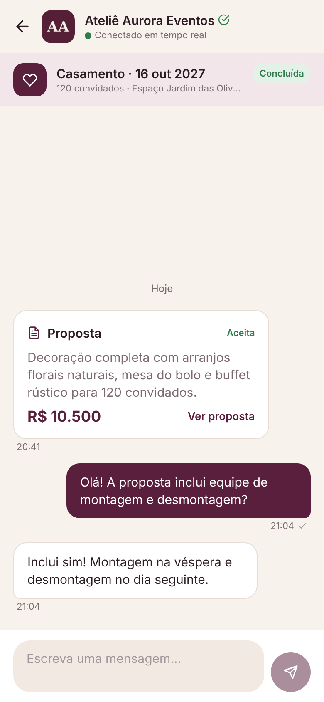
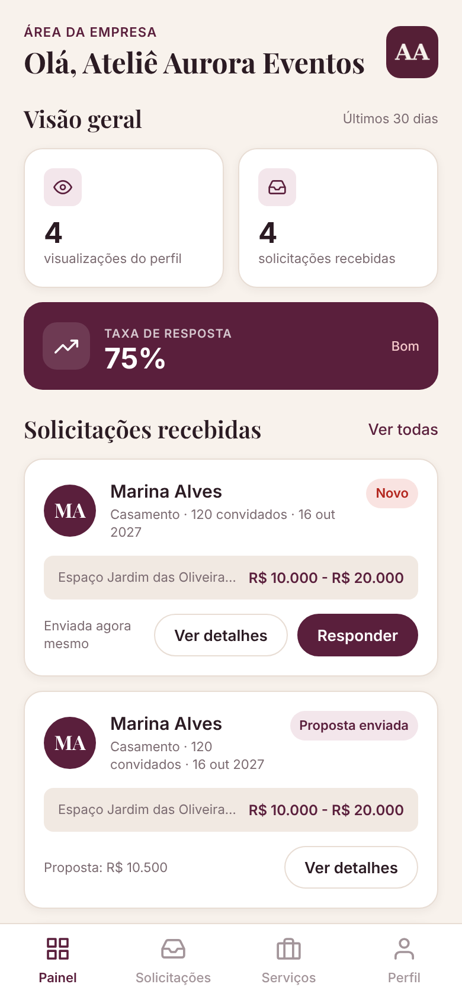

# SyncEvents

App Android que conecta **clientes** que estão organizando um evento a **empresas organizadoras e prestadores de serviço**:
o cliente encontra empresas, pede orçamento, conversa em tempo real e recebe propostas; a empresa divulga seus serviços,
responde pedidos e acompanha seus indicadores.

| | |
|---|---|
| **Mobile** | React Native (Expo SDK 58) · TypeScript · Expo Router · TanStack Query · Zustand · react-hook-form + zod · STOMP |
| **Backend** | Java 21 · Spring Boot 3.5 (Web, Security, Data JPA, WebSocket) · JWT · PostgreSQL 16 · Flyway |
| **Testes** | JUnit 5 · Mockito · Testcontainers · MockMvc · Jest · React Native Testing Library · Maestro |

<p>
  
  
  
  
  
</p>

## Status

| Fase | Entrega | Histórias | Status |
|---|---|---|---|
| 0 | Fundação: monorepo, Docker, backend base, app base e design system | — | ✅ |
| 1 | Boas-vindas, login (e-mail ou CNPJ) e cadastro de cliente e de empresa | ID01, ID02, ID03 | ✅ |
| 2 | Perfil da empresa (logo, capa, portfólio) e serviços (rascunho, ativo/inativo) | ID04, ID05 | ✅ |
| 3 | Início do cliente, busca com filtros, perfil público da empresa, dados de demonstração | ID06, ID07 | ✅ |
| 4 | Pedido de orçamento, propostas, gestão pela empresa, painel com indicadores | ID08, ID10 | ✅ |
| 5 | Chat em tempo real (WebSocket/STOMP) com propostas na conversa | ID09 | ✅ |
| 6 | Avaliações (nota, destaques, média e % que recomendam no perfil e na busca) | ID11 | ✅ |
| 7 | Acabamento: revisão visual, acessibilidade, fluxos Maestro completos, APK de release | — | ⏳ |

Números atuais: **157 testes no backend** (94 unitários + 63 de integração com Postgres real) e **150 no mobile**,
todos passando, com typecheck, lint e Prettier sem erros.

## Funcionalidades

**Cliente**
- Cadastro em 2 etapas (CPF e foto opcionais) e login; sessão salva com segurança (SecureStore).
- Início com busca, categorias, banner e empresas recomendadas para a sua cidade.
- Busca por nome, serviço ou categoria (sem acento), com filtro por categoria e cidade, ordenação e rolagem infinita.
- Perfil da empresa com portfólio, serviços e preços, indicadores, WhatsApp e compartilhar.
- Pedido de orçamento em 3 etapas (dados → revisão → enviado), com fotos de inspiração.
- "Minhas solicitações" por status; aceitar ou recusar propostas; cancelar o pedido.
- Chat em tempo real com cada empresa, com a proposta aparecendo como card na conversa.
- Avaliação do evento concluído (nota, destaques e comentário), exibida no perfil da empresa.

**Empresa**
- Cadastro em 2 etapas com código público de 6 dígitos; login por e-mail ou CNPJ.
- Perfil editável (logo, capa, contatos, endereço, categorias e portfólio de até 12 fotos).
- Serviços com fotos, modelos de preço (fixo, a partir de, faixa, sob consulta), itens inclusos, rascunho e ativo/inativo.
- Painel com visualizações do perfil, solicitações e taxa de resposta dos últimos 30 dias (com variação).
- Gestão das solicitações: em análise, proposta, recusa e conclusão (máquina de estados validada no backend).
- Chat em tempo real com cada cliente.

## Como rodar

**Pré-requisitos:** Docker · Java 21 + Maven 3.9 · Node 20+ · Android Studio com emulador (ou aparelho).

```bash
# 1. Banco de dados
cp .env.example .env
docker compose up -d postgres

# 2. Backend (perfil dev: migrations + dados de demonstração na primeira vez)
cd backend
mvn spring-boot:run

# 3. App (em outro terminal)
cd mobile
cp .env.example .env
npm install
npx expo run:android      # ou: npx expo start --web  (só para ver a interface no navegador)
```

| Endereço | O quê |
|---|---|
| http://localhost:8080/api/v1 | API REST |
| ws://localhost:8080/ws | WebSocket (STOMP) do chat |
| http://localhost:8080/swagger-ui.html | Documentação interativa da API |
| http://localhost:8080/actuator/health | Saúde do backend |

- `EXPO_PUBLIC_API_URL` (em `mobile/.env`): `http://10.0.2.2:8080` no emulador Android; num aparelho físico, o IP da sua máquina.
- Variáveis do backend em `backend/.env.example`. Fora do perfil `dev`, `APP_JWT_SECRET` (32+ caracteres) é obrigatório.
- pgAdmin opcional: `docker compose --profile tools up -d` → http://localhost:5050.

### Contas de demonstração (perfil `dev`)

| Perfil | Login | Senha |
|---|---|---|
| Cliente | `marina@demo.syncevents.com` | `Senha@123` |
| Empresa | `contato@aurora.demo.syncevents.com` | `Senha@123` |

São criadas 10 empresas com logo, capa, portfólio e serviços (lista em
[`DemoSeeder.java`](backend/src/main/java/br/com/syncevents/seed/DemoSeeder.java)). Para desligar: `APP_SEED_DEMO=false`.

## Testes

```bash
cd backend && mvn verify                       # unitários + integração (Testcontainers; precisa do Docker)
TEST_DB_URL=jdbc:postgresql://localhost:5432/syncevents_test mvn verify   # sem Docker

cd mobile
npm test && npm run typecheck && npm run lint && npx prettier --check .
maestro test e2e/                              # E2E com o app instalado no emulador
```

O que cada suíte cobre: [`docs/testes.md`](docs/testes.md).

## Documentação

| Documento | Conteúdo |
|---|---|
| [`docs/arquitetura.md`](docs/arquitetura.md) | Visão geral, pacotes, telas, modelo de dados, fluxos de autenticação, orçamento e chat (com diagramas) |
| [`docs/api.md`](docs/api.md) | Contrato da API REST e do WebSocket, fase a fase, com exemplos e regras |
| [`docs/decisoes.md`](docs/decisoes.md) | Todas as decisões tomadas e diferenças em relação ao Figma (60 itens) |
| [`docs/testes.md`](docs/testes.md) | Estratégia de testes e o que cada suíte verifica |
| [`docs/telas/`](docs/telas/) | Prints de cada fase rodando contra o backend real |
| [`SYNCEVENTS_PLANO.md`](SYNCEVENTS_PLANO.md) | Plano original de implementação (produto, regras, fases) |

## Estrutura

```
syncevents/
├── docker-compose.yml        PostgreSQL 16 (+ pgAdmin opcional)
├── backend/                  Spring Boot, pacote por domínio em br.com.syncevents.*
│   └── src/main/resources/db/migration   V1…V6 (Flyway)
├── mobile/                   Expo
│   ├── src/app/              rotas (Expo Router): (auth), cliente, empresa, chat, conversas
│   ├── src/components/       design system
│   ├── src/api · hooks/      cliente HTTP e hooks do TanStack Query
│   ├── src/theme/            tokens (cores, tipografia, espaçamentos)
│   └── e2e/                  fluxos Maestro por fase
└── docs/                     arquitetura, API, decisões, testes, design e prints
```
