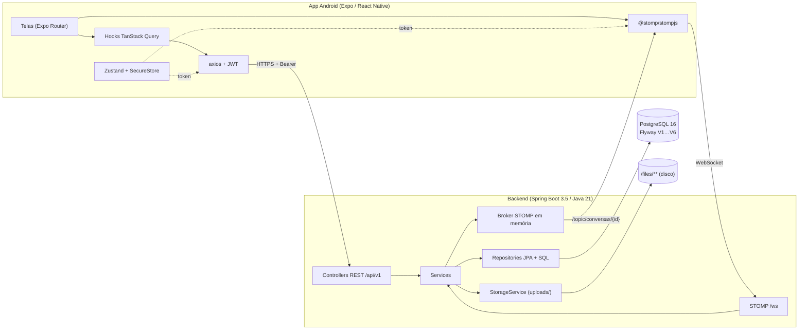
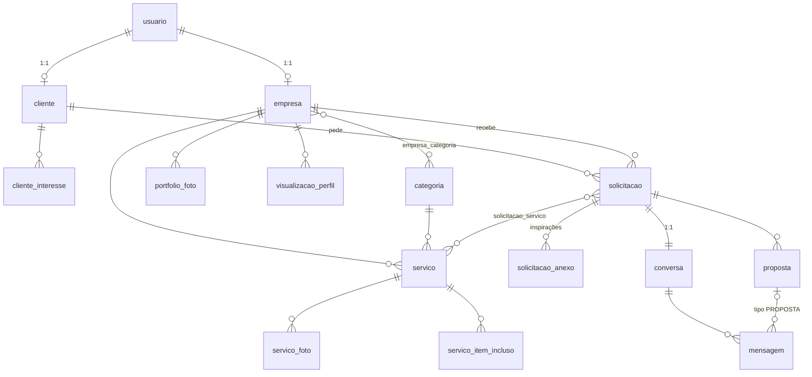
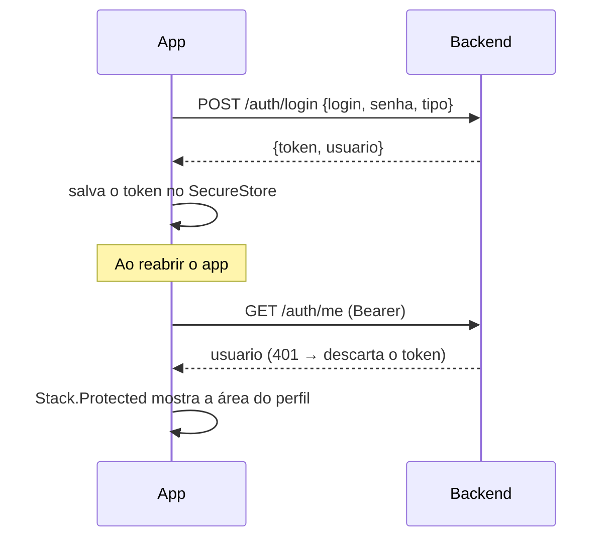
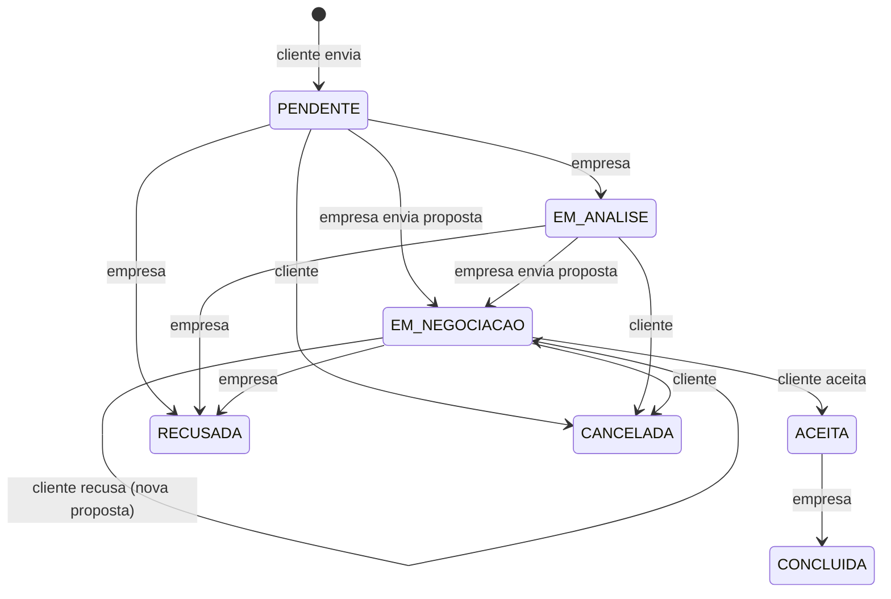
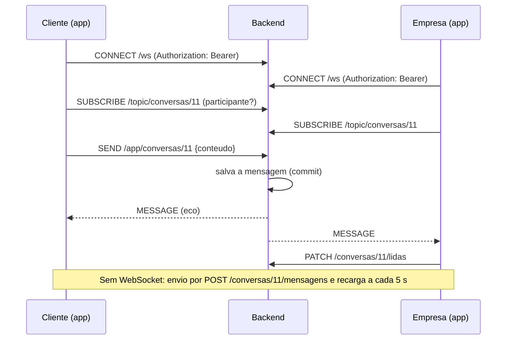

# Arquitetura do SyncEvents

## Visão geral

- **Monorepo** com `backend/` e `mobile/`; o banco roda no Docker (`docker-compose.yml`).
- O app conversa com o backend por **REST** (dados e ações) e por **WebSocket/STOMP** (chat em tempo real).
- Uploads (logos, capas, portfólio, fotos de serviço e inspirações) ficam em disco e são servidos em `/files/**`,
  atrás da interface `StorageService` (pode virar S3/MinIO sem mudar quem usa).

## Backend

Pacote por domínio, sempre `Controller → Service → Repository`, DTOs em `record` separados das entidades
e `@Transactional` nos services.

| Pacote | Responsabilidade |
|---|---|
| `config` | Security (stateless + JWT), CORS, OpenAPI, WebSocket/STOMP, propriedades `app.*` |
| `auth` | Cadastro de cliente e empresa, login, `/auth/me`, geração e validação de JWT |
| `usuario`, `cliente`, `empresa` | Entidades de conta e perfil; perfil e portfólio da empresa; visualizações |
| `categoria` | Categorias de serviço (seed) |
| `servico` | CRUD de serviços com fotos, itens inclusos, rascunho e ativo/inativo |
| `busca` | Busca textual sem acento (SQL + `unaccent`), recomendados e perfil público |
| `solicitacao` | Pedidos de orçamento, máquina de estados, propostas e painel da empresa |
| `chat` | Conversas, mensagens, histórico paginado, lidas e publicação no broker |
| `storage` | Gravação e remoção de imagens |
| `seed` | Dados de demonstração (perfil `dev`) |
| `common` | Formato de erro único (`ApiErro`), handler global, validadores (senha, CNPJ, telefone, nome) |

### Segurança

- Senhas com **BCrypt**; **JWT HS256** com validade de 7 dias (`sub` = id do usuário, `tipo` = CLIENTE/EMPRESA).
- O filtro `JwtAuthFilter` transforma o token em `ROLE_CLIENTE` ou `ROLE_EMPRESA`; as rotas exclusivas de cada perfil
  são protegidas no `SecurityConfig`.
- **Posse e participação** são checadas nos services: outra empresa editando um serviço recebe 403, quem não participa
  de uma solicitação ou conversa recebe 403.
- Todas as respostas de erro seguem o mesmo formato: `{ status, erro, mensagem, campos }`.

## Modelo de dados

Migrations Flyway: `V1` (unaccent) · `V2` usuários, clientes, empresas e categorias · `V3` serviços e portfólio ·
`V4` visualizações · `V5` solicitações, propostas e conversas · `V6` mensagens.
A tabela `avaliacao` chega na Fase 6.

## Fluxos

### Autenticação

### Solicitação de orçamento

Qualquer transição fora do diagrama responde **409**. Ao criar a solicitação, a **conversa** é criada junto.

### Chat em tempo real

Propostas enviadas pela empresa também viram mensagens no tópico; quando o cliente aceita ou recusa, a mesma mensagem
é publicada de novo com o status novo.

## Mobile

| Pasta | Conteúdo |
|---|---|
| `src/app/` | Rotas do Expo Router. `(auth)` público; `cliente/` e `empresa/` com abas próprias; `chat/` e `conversas` compartilhados. O acesso é controlado por `Stack.Protected` no layout raiz. |
| `src/components/` | Design system (Button, TextInput, Chip, Card, Select, SwitchCard, EmpresaCard, SolicitacaoCard, BolhaMensagem...) |
| `src/theme/` | Tokens de cor, tipografia (Playfair Display + Inter), espaçamentos e raios: nenhum componente usa cor fixa |
| `src/api/` | Cliente axios (injeta o JWT, trata 401) e funções por recurso |
| `src/hooks/` | Hooks do TanStack Query: as telas só falam com a API por eles |
| `src/chat/` | Conexão STOMP (reconexão automática) |
| `src/schemas/` | Validações zod, com as mesmas regras e mensagens do backend |
| `src/store/` | Sessão (Zustand + SecureStore) |
| `src/utils/` | Máscaras (telefone, CNPJ, CPF, moeda), formatação de datas e preços, helpers do chat |

### Telas por perfil

| Cliente | Empresa | Ambos |
|---|---|---|
| Início · Buscar · Minhas solicitações · Perfil (abas) | Painel · Solicitações · Serviços · Perfil (abas) | Boas-vindas · Login · Cadastros |
| Perfil da empresa · Pedido de orçamento · Detalhe da solicitação | Criar/editar serviço · Editar perfil · Detalhe da solicitação | Conversas · Chat |
